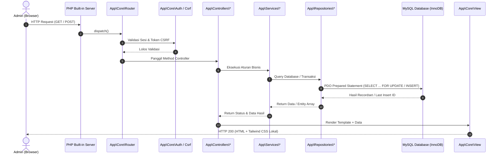

# Dokumentasi Arsitektur Perangkat Lunak — RestoReserve

Dokumen ini menjelaskan rancangan arsitektur, pola desain, dan siklus hidup pemrosesan HTTP request aplikasi **RestoReserve**.

---

## 1. Prinsip & Pola Arsitektur (Architecture Pattern)

Aplikasi dibangun menggunakan pola **MVC (Model-View-Controller) Sederhana** yang diperluas dengan lapisan **Service** dan **Repository**:

1. **Presentation Layer (View):** Template PHP yang memanfaatkan utilitas Tailwind CSS v4 hasil kompilasi lokal dan Vanilla JavaScript untuk micro-interaction preview harga.
2. **Controller Layer:** Menerima HTTP request, memvalidasi token CSRF, memeriksa sesi autentikasi, meneruskan parameter ke Service/Repository, dan mengembalikan tampilan View atau respons JSON/redirect.
3. **Domain / Service Layer:** Berisi aturan bisnis murni restoran (misal perhitungan bentrokan jadwal, pembatasan kapasitas meja, kalkulasi snapshot pesanan makanan). Bebas dari kode antarmuka.
4. **Data Access Layer (Repository):** Bertanggung jawab atas seluruh komunikasi SQL dengan basis data MySQL menggunakan PDO Prepared Statements, manajemen transaksi, dan row-level locking.
5. **Persistence Layer (Database):** MySQL 8.0+ / MariaDB dengan engine InnoDB yang mendukung transaksi ACID dan foreign key constraints.

---

## 2. Diagram Aliran Permintaan (Request Lifecycle)

---

## 3. Komponen Utama dan Tanggung Jawab

| Lapisan | Komponen | Tanggung Jawab |
|---|---|---|
| **Core** | `Database` | Singleton connection PDO MySQL dengan error mode exception dan disable emulate prepares. |
| **Core** | `Router` | Pencocokan URL path via regex bernama `{param}`, pemisahan query string, dispatch ke controller. |
| **Core** | `Auth` | Pengelolaan session admin, verifikasi hash password (`password_verify`), `session_regenerate_id`. |
| **Core** | `Csrf` | Generator token acak berbasis sesi dan verifikasi timing-safe dengan `hash_equals()`. |
| **Core** | `View` | Template engine berbasis output buffering (`ob_start`) dengan dukungan layout wrapping. |
| **Core** | `BaseController` | Kelas induk penyedia helper view, redirect, flash error, dan validasi CSRF. |
| **Services** | `BookingRules` | Aturan domain murni: durasi 2 jam, deteksi overlap jadwal `[startA, endA) vs [startB, endB)`, validasi kapasitas. |
| **Services** | `OrderCalculator` | Kalkulator domain murni: perhitungan subtotal `quantity × unit_price`, konsolidasi item duplikat, kalkulasi grand total. |
| **Services** | `ReservationService` | Orkestrator aturan bisnis reservasi dan validasi transisi status terkait pesanan. |
| **Services** | `OrderService` | Orkestrator siklus hidup order (wajib reservasi `confirmed`, snapshot harga). |
| **Services** | `ReportService` | Agregasi data laporan keuangan dan sanitasi spreadsheet injection pada ekspor CSV. |
| **Repositories** | `CustomerRepository` | Query CRUD data pelanggan. |
| **Repositories** | `TableRepository` | Query CRUD meja dan pengecekan nomor unik. |
| **Repositories** | `MenuRepository` | Query CRUD menu dan filter ketersediaan. |
| **Repositories** | `ReservationRepository`| Transaksi pembuatan reservasi dengan row-locking `SELECT ... FOR UPDATE` pada meja. |
| **Repositories** | `OrderRepository` | Transaksi pembuatan order dan penulisan snapshot harga item ke `order_items`. |

---

## 4. Alasan Pemilihan Arsitektur

1. **Pemenuhan Standar Kompetensi:** Penguji dapat melihat langsung implementasi class, method, inheritansi, encapsulation, perulangan, dan exception handling tanpa tertutup oleh keajaiban (magic) framework raksasa seperti Laravel.
2. **Kemandirian Pengujian (Testability):** Logika inti bisnis (`BookingRules`, `OrderCalculator`) dipisahkan sepenuhnya dari I/O database sehingga dapat diuji menggunakan PHPUnit secara cepat dan deterministik tanpa memerlukan koneksi MySQL.
3. **Pencegahan Concurrency Issue:** Penggunaan transaksi eksplisit dengan row locking pada repository memastikan tidak ada dua pemesanan meja yang bentrok ketika admin membuka dua tab bersamaan.
4. **Zero-Dependency Demo:** Seluruh CSS telah dibundel secara lokal (offline ready), dan server dapat dijalankan hanya dengan PHP executable bawaan.
