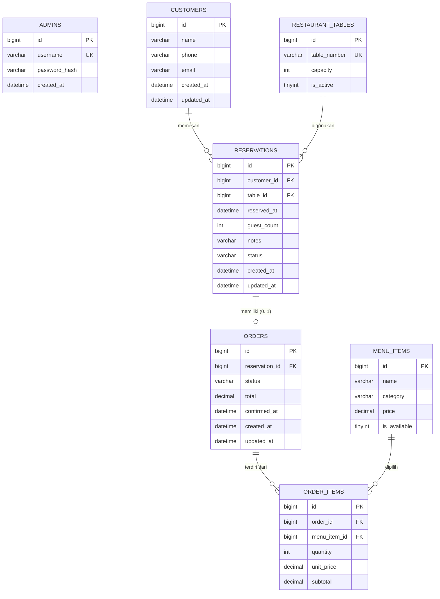

# Dokumentasi Basis Data Relasional — RestoReserve

Dokumen ini menjelaskan struktur 7 tabel basis data MySQL InnoDB, relasi antar tabel, Entity-Relationship Diagram (ERD), konsep snapshot harga, dan contoh query SQL JOIN yang digunakan secara aktual dalam aplikasi.

---

## 1. Entity-Relationship Diagram (ERD)



---

## 2. Struktur 7 Tabel Relasional

### 2.1 `admins`
Menyimpan akun administrator sistem. Password disimpan dalam bentuk hash bcrypt.
- `id` (BIGINT UNSIGNED, PK, AUTO_INCREMENT)
- `username` (VARCHAR(50), NOT NULL, UNIQUE)
- `password_hash` (VARCHAR(255), NOT NULL)
- `created_at` (DATETIME, NOT NULL)

### 2.2 `customers`
Menyimpan data tamu restoran.
- `id` (BIGINT UNSIGNED, PK, AUTO_INCREMENT)
- `name` (VARCHAR(100), NOT NULL)
- `phone` (VARCHAR(20), NOT NULL)
- `email` (VARCHAR(150), NULL)
- `created_at`, `updated_at` (DATETIME, NOT NULL)

### 2.3 `restaurant_tables`
Menyimpan denah meja restoran dan kapasitas maksimum pengunjung.
- `id` (BIGINT UNSIGNED, PK, AUTO_INCREMENT)
- `table_number` (VARCHAR(20), NOT NULL, UNIQUE)
- `capacity` (INT UNSIGNED, NOT NULL)
- `is_active` (TINYINT(1), NOT NULL, DEFAULT 1)

### 2.4 `menu_items`
Daftar master menu makanan dan minuman restoran.
- `id` (BIGINT UNSIGNED, PK, AUTO_INCREMENT)
- `name` (VARCHAR(120), NOT NULL)
- `category` (VARCHAR(30), NOT NULL) &mdash; 'Makanan' atau 'Minuman'
- `price` (DECIMAL(12,0), NOT NULL) &mdash; Nominal integer Rupiah
- `is_available` (TINYINT(1), NOT NULL, DEFAULT 1)

### 2.5 `reservations`
Menyimpan jadwal reservasi meja berdurasi 2 jam (120 menit).
- `id` (BIGINT UNSIGNED, PK, AUTO_INCREMENT)
- `customer_id` (BIGINT UNSIGNED, FK &rarr; `customers.id`, ON DELETE RESTRICT)
- `table_id` (BIGINT UNSIGNED, FK &rarr; `restaurant_tables.id`, ON DELETE RESTRICT)
- `reserved_at` (DATETIME, NOT NULL) &mdash; Waktu mulai lokal
- `guest_count` (INT UNSIGNED, NOT NULL)
- `notes` (VARCHAR(255), NULL)
- `status` (VARCHAR(20), NOT NULL, DEFAULT 'pending') &mdash; enum: pending, confirmed, completed, cancelled
- `created_at`, `updated_at` (DATETIME, NOT NULL)
- *Indeks Khusus:* `idx_reservations_conflict (table_id, reserved_at, status)`

### 2.6 `orders`
Header pesanan makanan yang terhubung 1-ke-1 secara unik dengan reservasi terkonfirmasi.
- `id` (BIGINT UNSIGNED, PK, AUTO_INCREMENT)
- `reservation_id` (BIGINT UNSIGNED, FK &rarr; `reservations.id`, UNIQUE, ON DELETE RESTRICT)
- `status` (VARCHAR(20), NOT NULL, DEFAULT 'draft') &mdash; draft, confirmed, cancelled
- `total` (DECIMAL(12,0), NOT NULL, DEFAULT 0)
- `confirmed_at` (DATETIME, NULL)
- `created_at`, `updated_at` (DATETIME, NOT NULL)

### 2.7 `order_items`
Rincian item menu yang dipesan beserta snapshot harga satuan saat pemesanan.
- `id` (BIGINT UNSIGNED, PK, AUTO_INCREMENT)
- `order_id` (BIGINT UNSIGNED, FK &rarr; `orders.id`, ON DELETE RESTRICT)
- `menu_item_id` (BIGINT UNSIGNED, FK &rarr; `menu_items.id`, ON DELETE RESTRICT)
- `quantity` (INT UNSIGNED, NOT NULL)
- `unit_price` (DECIMAL(12,0), NOT NULL) &mdash; **Snapshot Harga**
- `subtotal` (DECIMAL(12,0), NOT NULL)
- *Unique Constraint:* `UNIQUE KEY uq_order_menu (order_id, menu_item_id)`

---

## 3. Konsep dan Alasan "Snapshot Harga"

Dalam sistem restoran dan e-commerce standar industri, **harga menu pada tabel master (`menu_items.price`) dapat berubah sewaktu-waktu** karena inflasi atau promosi.

Jika tabel `order_items` tidak menyimpan `unit_price` dan hanya mengandalkan relasi `JOIN menu_items`, maka ketika harga "Nasi Goreng" dinaikkan dari Rp25.000 menjadi Rp30.000:
1. Seluruh pesanan historis bulan lalu nilainya akan otomatis berubah dan membengkak.
2. Laporan keuangan masa lalu menjadi keliru dan tidak dapat dipertanggungjawabkan (melanggar prinsip audit).

**Solusi yang Diimplementasikan:**
Saat pesanan disimpan ke `order_items`, harga menu saat itu disalin langsung ke kolom `order_items.unit_price`. Nilai subtotal dihitung dari snapshot tersebut (`quantity × unit_price`). Dengan demikian, data historis tetap abadi dan akurat selamanya.

---

## 4. Contoh Query JOIN Aktual yang Digunakan

### 4.1 Query Detail Reservasi Lengkap (JOIN 4 Tabel)
Digunakan pada `ReservationRepository::findById()`:
```sql
SELECT r.*, 
       c.name AS customer_name, c.phone AS customer_phone, c.email AS customer_email,
       t.table_number, t.capacity AS table_capacity, t.is_active AS table_is_active,
       o.id AS order_id, o.status AS order_status, o.total AS order_total
FROM reservations r
JOIN customers c ON r.customer_id = c.id
JOIN restaurant_tables t ON r.table_id = t.id
LEFT JOIN orders o ON o.reservation_id = r.id
WHERE r.id = :id
LIMIT 1;
```

### 4.2 Query Pengecekan Bentrokan Jadwal dengan Kunci Baris
Digunakan pada `ReservationRepository::createWithLock()`:
```sql
-- 1. Kunci baris meja
SELECT id, capacity, is_active FROM restaurant_tables WHERE id = :table_id FOR UPDATE;

-- 2. Cek apakah ada jadwal reservasi aktif yang bertabrakan (2 jam durasi)
SELECT id 
FROM reservations 
WHERE table_id = :table_id 
  AND status IN ('pending', 'confirmed') 
  AND reserved_at < :new_end 
  AND DATE_ADD(reserved_at, INTERVAL 2 HOUR) > :new_start 
LIMIT 1;
```
